Follow this guide to put your app online at `https://<name>.mit-sdg.dev`. The class's platform, 6.1040 Apps at [mit-sdg.dev](https://mit-sdg.dev), builds and runs a commit you choose from GitHub. It creates a database for your app, restarts the app if it crashes, and stores the logs. Once your app is running, anyone with the link can try it.

Expect one to two hours the first time. About half of that is changes to your code and settings, and the rest is waiting while the platform sets up your database and deploys your app. Start with step 1, on your own computer, and follow the numbered steps in order. The screenshots show the reservations app from [Developing a sync-engine app locally](sync-engine-local-dev.md); use your own app's repository and settings.

<h2 id="prepare">1. Prepare your code</h2>

The platform builds your app from a commit on GitHub. It installs your packages from your lockfile (`bun.lock`, which records the exact version of each package), runs your build script if you have one, and then runs your start script. It doesn't use your `Dockerfile` or `compose.yaml`.

If you followed the local guide and kept its frontend, this step is short: change the Bun version, check the other items in the list below, and skip the Vue section.

### Changes every app needs

- **Set the Bun version.** `sync-engine setup` wrote `"packageManager": "bun@1.3.4"` in `package.json`. Change that line to:

  ```json
    "packageManager": "bun@1.4.0",
  ```

  The platform builds and runs your app with the version named here. Bun 1.3.4 runs only the first script given to `bun run --parallel`, so only part of an app like the local guide's would start, and it can't read a `bun.lock` written by Bun 1.4. Bun 1.4.0 reads the lockfile from any Bun 1.3 or 1.4 on your computer. On your computer, Bun ignores this line, so you don't need to update your own Bun, and you wouldn't see either problem before deploying.

- **Use the database named in the connection string.** Where your code names the database, call `client.db()` with no name, not `client.db("myapp")`. On the platform, your app may use only the database named in the connection string it's given. In `.env`, check that `MONGODB_URL` names your database, as in `.../myapp?authSource=admin`. Without a name there, `client.db()` uses a database called `test`.

- **Have a health check.** The platform requests a path such as `/health` and checks for a success status (200 to 299), with a short response (at most 4 KB) and no redirect. If your app has no health check, copy the `/health` route from `src/main.ts` in the local guide's step 3, "Putting it together". That route also checks that the app can read MongoDB.

- **Keep `.env` out of git**, because project repositories are public. Note which variables your code reads from `.env`; you'll enter them on the platform in step 4.

### How visitors reach your app

Visitors reach one server. It must listen on the port in the `PORT` variable, at the address in `HOST`. The platform sets `PORT` to the port you choose in step 3, and `HOST` to `0.0.0.0`, which accepts connections from outside the machine. That one server sends the pages and handles the API requests.

<h3 id="two-servers">If you kept the local guide's frontend</h3>

You don't need to change your servers. Check that `start` in `package.json` is `bun run --parallel start:backend start:frontend`. It runs both servers: the frontend listens on `PORT` at `0.0.0.0` and passes `/api` and `/health` on to the backend, which stays on `127.0.0.1:4000`.

<h3 id="vue">If your frontend uses Vue</h3>

Vite's development server doesn't run on the platform. Instead, Vite builds your pages into files, and your backend sends them, so one server handles both the pages and the API.

These steps assume your Vue app is in a folder named `frontend` at the root of your repository. If yours has another name, use it in place of `frontend`.

- **Build with Vite alone.** In `frontend/package.json`, set the build script to:

  ```json
      "build": "vite build",
  ```

  If it already says `vite build`, leave it. The build script from `create-vue` with TypeScript also runs `vue-tsc`, which needs Node.js, and the platform's Bun has none. To check your types, run `npm run type-check` in `frontend` before you push.

- **Build the frontend and start the backend from the root.** In the root `package.json`, inside `"scripts"`, add `build` and make `start` run the backend alone:

  ```json
      "build": "bun run --cwd frontend build",
      "start": "bun src/main.ts",
  ```

  If `start` already says `bun src/main.ts`, leave it. If you have `start:backend` and `start:frontend` from the local guide, you can delete them.

- **Send the built files from the backend.** In `src/main.ts`, add these lines above `Bun.serve`:

  ```ts
  const dist = `${import.meta.dir}/../frontend/dist`;

  // Send a file that `vite build` made, or index.html for any other path.
  async function page(request: Request) {
    const file = Bun.file(dist + new URL(request.url).pathname);
    return new Response((await file.exists()) ? file : Bun.file(`${dist}/index.html`));
  }
  ```

  Then keep your own `Bun.serve` and add one line inside it, after the `},` that closes `routes`:

  ```ts
    fetch: page,
  ```

  Bun tries `routes` first, so `/api/...` and `/health` still reach your backend. Bun calls `page` for every other path, so a page from Vue Router still loads when someone reloads it.

- **Call the API by path.** Make the frontend call `/api/...`, not `http://localhost:3000/api/...`. On the deployed app, `localhost` refers to each visitor's own computer. To find these calls, search `frontend/src` for `localhost`. So that `/api` still reaches your backend while you develop, check that `frontend/vite.config.ts` passes it on. If `defineConfig` has no `server` entry, add one:

  ```ts
    server: { proxy: { "/api": "http://127.0.0.1:3000" } },
  ```

- **Install the frontend with Bun.** Run `bun install` in `frontend` and commit `frontend/bun.lock`, even if you created the frontend with npm. The platform installs each folder from its own `bun.lock`. If `frontend` also has `package-lock.json`, delete it. From now on, add packages with `bun add` in `frontend`, not `npm install`.

You still develop with Vite's development server, as before.

<h3 id="sign-in">If your app keeps sessions in a cookie</h3>

Skip this unless your `httpPolicy` sets `publicOrigin`. It does if you keep sessions in a cookie, as ConceptBox does.

Requests that sign in, sign out, or use the session are refused with status 403 and `{"error":"FORBIDDEN"}` unless they come from a page at the `publicOrigin` address. Where your code calls `httpPolicy`, read `publicOrigin` from the environment variable `PUBLIC_ORIGIN`, so that the platform can set it to `https://<name>.mit-sdg.dev`:

```ts
  publicOrigin: process.env.PUBLIC_ORIGIN ?? "http://localhost:5173",
```

The fallback is the address you open while you develop, such as `http://localhost:5173` with Vite. `localhost` and `127.0.0.1` count as different addresses. Don't put `PUBLIC_ORIGIN` in `.env`; you'll set it on the platform in step 4.

<h3 id="try-it">Try it, then push</h3>

Do this last, whatever your setup. Run your app the way the platform will:

1. Stop `bun run dev` with Ctrl+C. If you started the local guide's containers with `bun run up`, run `bun run down`.
2. Start MongoDB. If you followed the local guide, run `bun run db:up`. On macOS or Windows, if you've restarted your computer since, run `podman machine start` first.
3. If your app has a build script, as a Vue app does, run `bun run build`.
4. Run `bun run start`. If your app keeps sessions in a cookie, set `PUBLIC_ORIGIN` to the address you'll open, `http://localhost:3000`, or `http://localhost:8080` with the local guide's frontend. On macOS or Linux:

   ```sh
   PUBLIC_ORIGIN=http://localhost:3000 bun run start
   ```

   In PowerShell:

   ```powershell
   $env:PUBLIC_ORIGIN="http://localhost:3000"; bun run start
   ```

On Windows, a firewall prompt may appear for Bun. Click **Cancel**; your app still works on your own computer.

Open http://localhost:3000/health, or http://localhost:8080/health with the local guide's frontend, and check that it reports ok. The local guide's route shows `{"status":"ok"}`. Then open the same address without `/health` and use the app, including signing in if it has sign-in.

Press Ctrl+C to stop the app. If you set `PUBLIC_ORIGIN` in PowerShell, close that window, so the variable doesn't stay set. Then commit and push.

## 2. Sign in and create the app

Open [mit-sdg.dev](https://mit-sdg.dev) and click **Sign in with your class account**. It's the same account you use on Commons. The first time, Commons shows a permission page for `mit-sdg.dev`, listing your name, username, and email. Click **Allow**.

<figure class="guide-step guide-step--compact">
  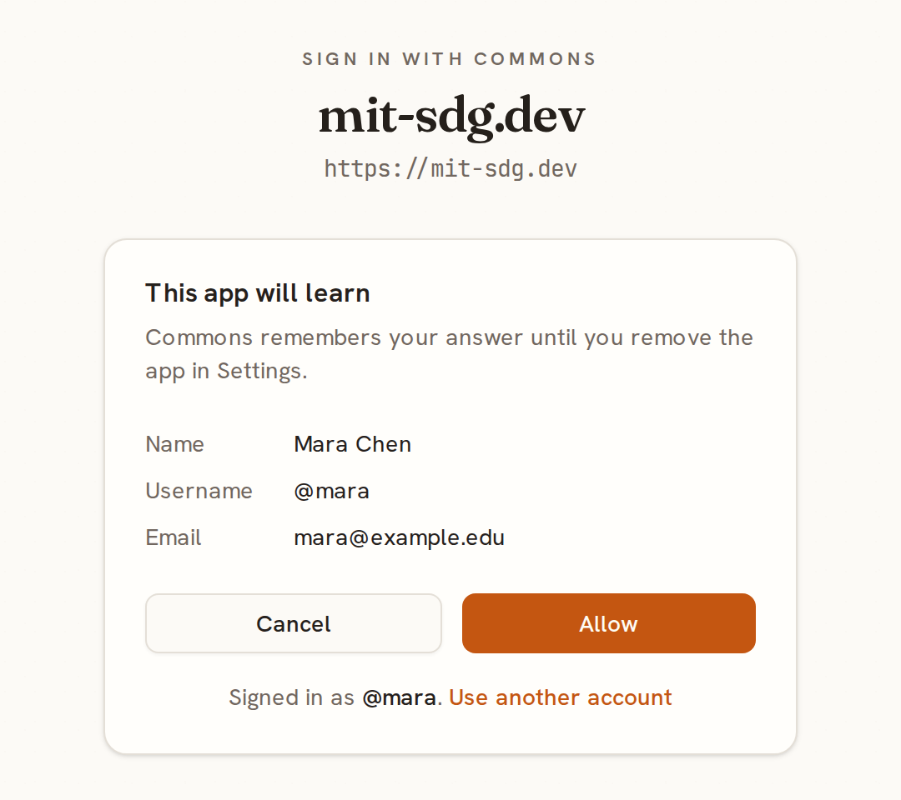
  <figcaption>To change your answer later, remove mit-sdg.dev from the apps listed in your Commons settings.</figcaption>
</figure>

You can't rename an app, so choose its name with care. The name becomes part of your app's address: the app named `reservations` is at `https://reservations.mit-sdg.dev`. Use 3 to 40 lowercase letters, numbers, and single hyphens. Start with a letter, and end with a letter or number.

Click **Create app** and type the name. If someone has taken it, or it's reserved, like `admin`, you'll see an error.

<figure class="guide-step guide-step--compact">
  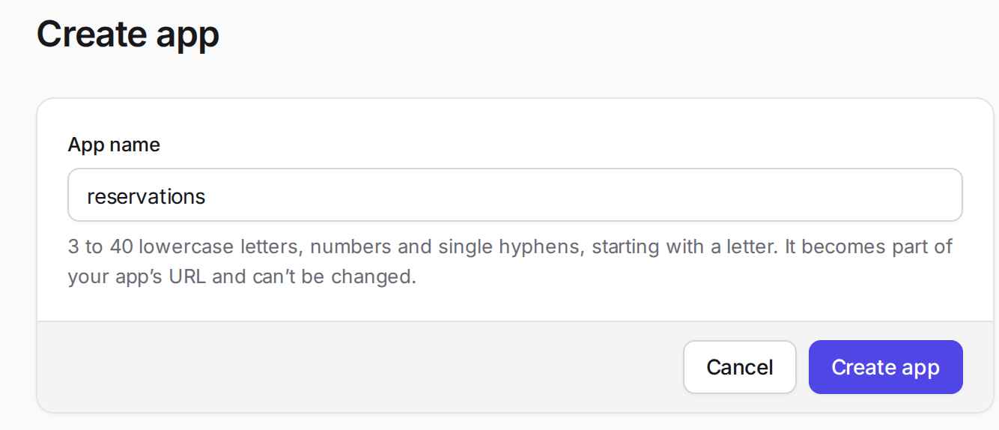
  <figcaption>The example app is called <code>reservations</code>. Use your own app's name.</figcaption>
</figure>

You can have two apps, and a stopped app still counts toward the two. You can't delete an app yourself, so use one for your personal project and keep the other for your team project. On a team, one person creates the team's app and adds the others, as step 6 shows. If you need an app removed, ask the course staff on the class forum on Commons.

## 3. Fill in the settings

Creating the app opens its **Settings** tab. Fill in the fields for your app.

- **Repository URL**: your repository on GitHub. The screenshot uses `https://github.com/mit-sdg/sync-engine-reservations`. If your repository is private, see [Deploying from a private repository](#private-repository).
- **Branch**: usually `main`. You'll choose an exact commit from it each time you deploy.
- **Runtime**: **Bun**, or **Node.js** if your app uses it instead.
- **Package directories**: `.`, the repository root. For a Vue app, add `frontend` on a second line.
- **Build script**: type `build` for a Vue app. Leave it empty if your app has no build script, like the reservations app.
- **Start script**: `start`. Type the script's name, not the command it runs.
- **Port**: `3000`. The platform sets `PORT` to this number. With the local guide's frontend, the frontend listens on it and the backend stays on 4000, so don't choose 4000.
- **Health check path**: your app's health check, such as `/health`.

Click **Save settings**.

<figure class="guide-step">
  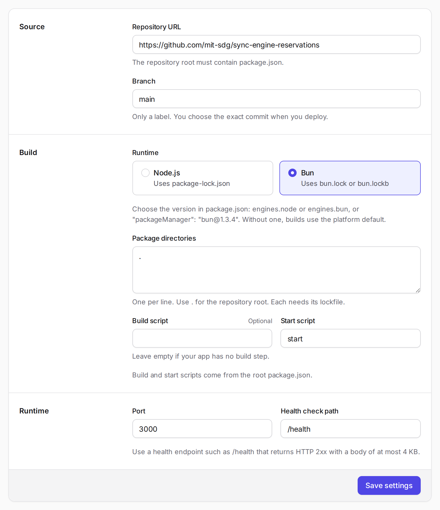
  <figcaption>The reservations app's settings. It has no build script, so that field is empty. The hint under <strong>Runtime</strong> names <code>bun@1.3.4</code> only as an example; use <code>bun@1.4.0</code>, as in step 1.</figcaption>
</figure>

## 4. Add a database and your variables

If your app uses MongoDB, scroll down to **Databases and storage** on the **Settings** tab, click **Add MongoDB**, and confirm. Add only the database your app uses: you can't remove one yourself. If you add one by mistake, ask the course staff on the forum.

<figure class="guide-step">
  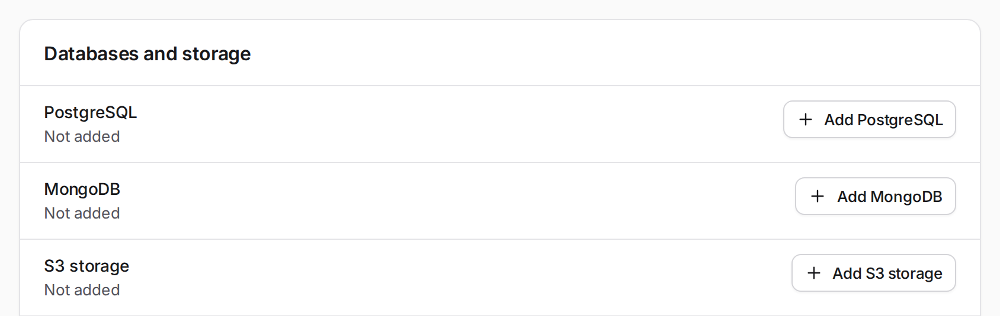
  <figcaption>Add the database or storage your app uses.</figcaption>
</figure>

In the next dialog, type the name of the variable your code reads for the connection string. The field starts as `MONGODB_URI`. If you followed the local guide, change it to `MONGODB_URL`. Click **Save variables**.

<figure class="guide-step guide-step--compact">
  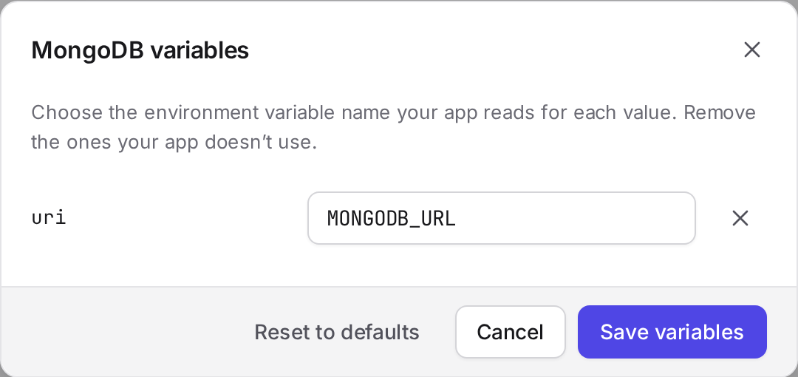
  <figcaption>The variable name must match your code. The platform supplies the connection string.</figcaption>
</figure>

The platform's connection string already includes the database name and the password, so your code uses it unchanged. The new database starts empty; your local data stays on your computer.

Your database runs on its own server, so other apps can't slow it down. It holds up to 2 GB and takes up to 10 connections at a time, and the **Settings** tab shows how much of that you're using. Create one `MongoClient` when your app starts and use it everywhere, as the local guide's code does.

Wait until MongoDB shows **Ready** instead of **Setting up**. Until then, a deployment or a variable change is refused with "Check the change in the app's Overview before trying again." The platform makes one change at a time, across all your apps.

Then add your other environment variables under **Environment variables**:

- Add each variable from your `.env` file, such as API keys. If `.env` has only the database's variable, as in the local guide, there's nothing to add.
- Leave out the database's variable, `PORT`, and `HOST`. The platform sets these.
- If your app keeps sessions in a cookie, add `PUBLIC_ORIGIN` with your app's address, such as `https://reservations.mit-sdg.dev`. Start it with `https://`.

Once saved, a value is hidden on the page, but the platform still passes it to your app. Saving a variable restarts your app if it's running.

The platform sets these variables when your app starts, not during the build, so a `VITE_` variable is empty in your built pages. To use a value in the frontend, send it from a backend endpoint.

## 5. Deploy

Open the **Deploy** tab and choose a commit from your branch, usually the newest. The platform checks that the commit has `package.json`, the scripts you named, and a lockfile. It also shows the Bun or Node.js version the commit names.

<figure class="guide-step">
  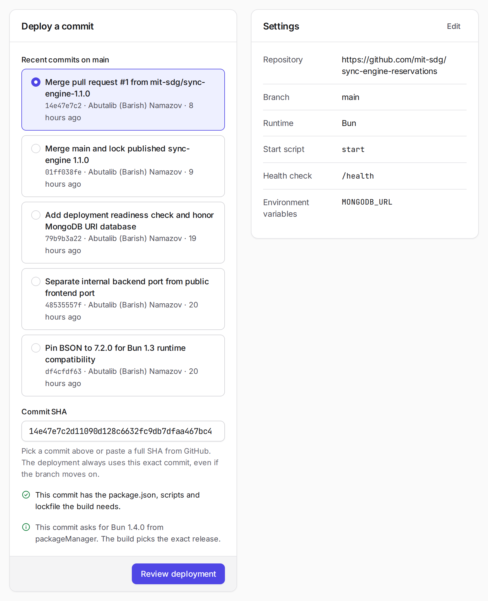
  <figcaption>Check the selected commit and settings before deploying.</figcaption>
</figure>

Click **Review deployment**. Check that the commit is the one you meant and that your variables are listed, then click **Deploy**. Progress appears on the **Deploy** tab.

<figure class="guide-step">
  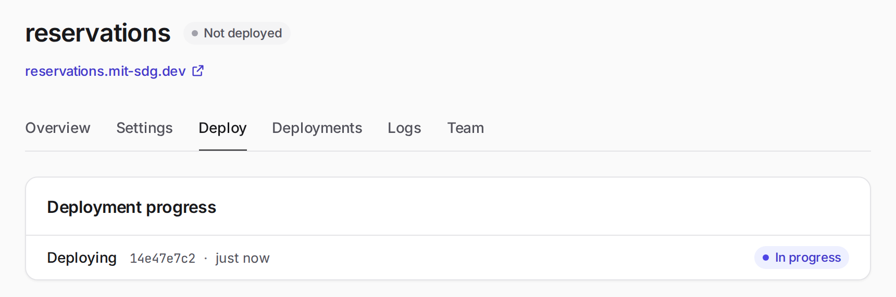
  <figcaption>On the first deployment, the app stays marked "Not deployed" until it finishes.</figcaption>
</figure>

A deployment usually takes about 10 minutes, mostly while CSAIL's servers start the machines that build and run your app. You can close the page and come back later. The deployment keeps going, and the **Overview** tab shows whether it succeeded.

If you stay on the page, you'll see "Deployment succeeded. Your app is running this commit." when it finishes.

<figure class="guide-step">
  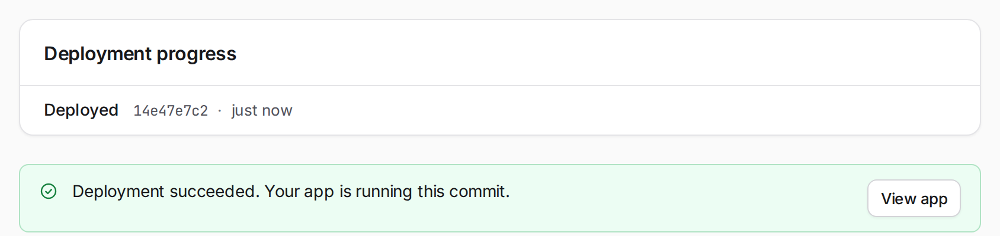
  <figcaption>The selected commit is now running at your app's address.</figcaption>
</figure>

**View app** opens the app's **Overview** tab. Your app's address, such as `reservations.mit-sdg.dev`, is the link just below the app's name. Open it and try something that saves data: create an item, reload the page, and check that it's still there.

If the deployment fails, your code is unchanged, and an app that was already running keeps running its previous commit. The **Deploy** tab shows the reason, and [If something goes wrong](#troubleshooting) lists the common causes. Fix the cause, push, and deploy again.

Once your app works, share the link with your classmates.

## 6. Manage your app

Come back to this step when you change your app or add teammates.

**Deploying a change.** Push your code to GitHub, then choose the new commit on the **Deploy** tab. Pushing alone doesn't deploy it. On the **Overview** tab, **Deploy latest** chooses the newest commit on your branch and asks you to confirm.

The **Overview** tab also shows your app's health and the commit it's running, and lets you stop or restart it.

<figure class="guide-step">
  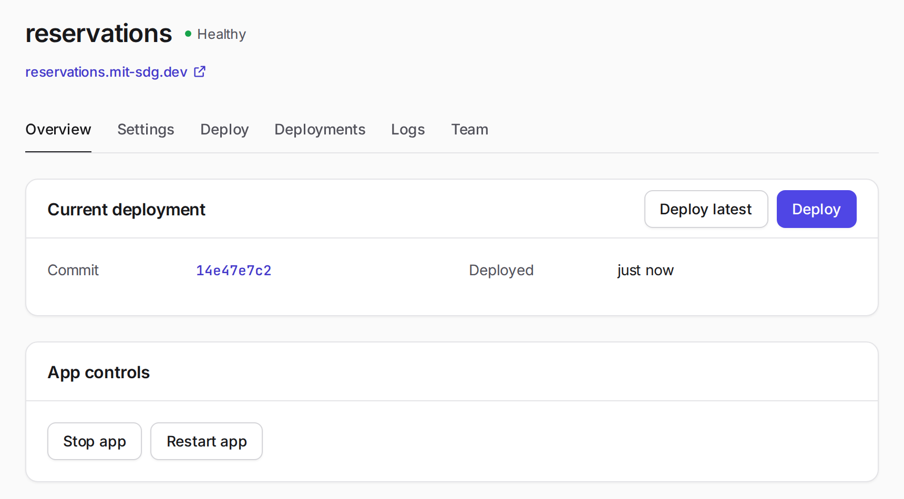
  <figcaption>"Healthy" means the app is running and its health check passes.</figcaption>
</figure>

**Going back to an earlier commit.** The **Deployments** tab lists past deployments, with each one's commit, build output, and the exact Bun or Node.js version it used. If a commit deploys but breaks something, open an earlier deployment and click **Deploy this commit again**. This deploys the old code with your current settings and environment variables. It doesn't bring back earlier database contents.

<figure class="guide-step">
  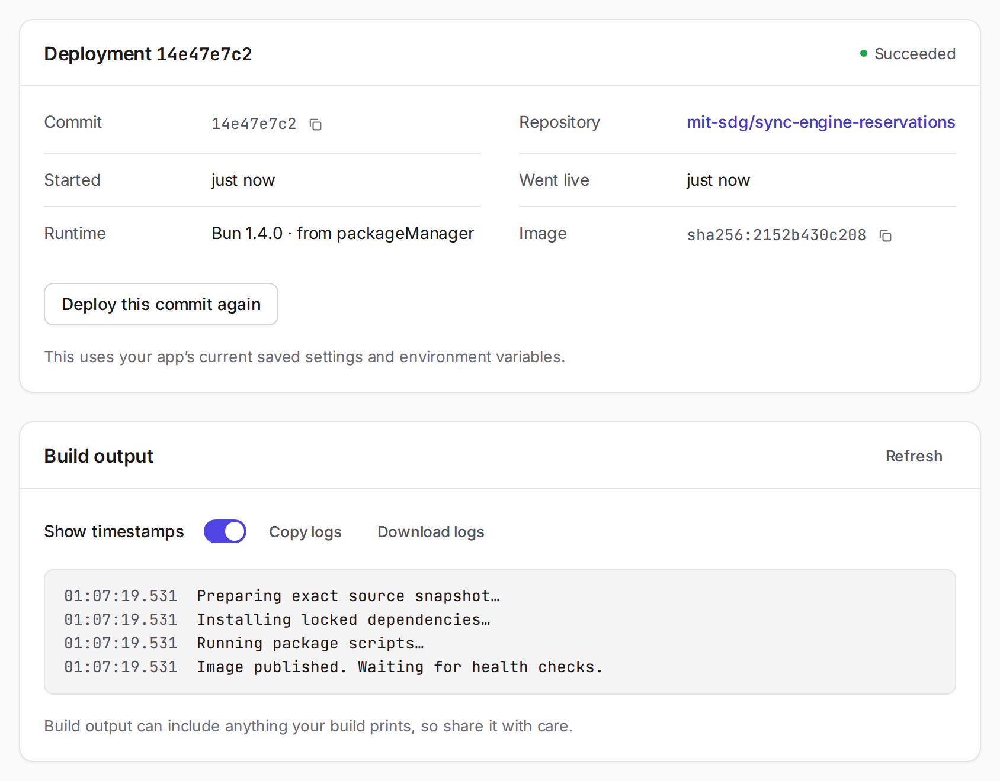
  <figcaption>The <strong>Runtime</strong> row records the version used and where it was specified.</figcaption>
</figure>

**Reading what your app prints.** The **Logs** tab shows your app's output, with **Output** and **Errors** kept apart, much like `bun run logs` did locally.

<figure class="guide-step">
  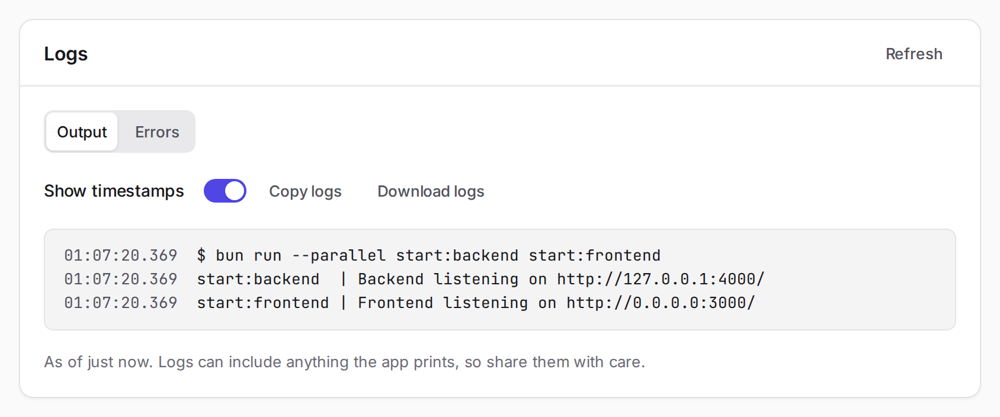
  <figcaption>The example runs two servers, with the frontend on the port visitors reach. A Vue app shows one line, its backend on <code>0.0.0.0:3000</code>.</figcaption>
</figure>

**Adding teammates.** On the **Team** tab, the app's owner adds or removes teammates by their Commons username. Each teammate must sign in at mit-sdg.dev once before they can be added. Teammates can change settings, deploy, and read logs.

<h2 id="troubleshooting">If something goes wrong</h2>

For a failed build, open its build output on the **Deployments** tab. If the app built but stopped, click **See why it stopped** on the **Deploy** tab. If the app runs but misbehaves, check the **Logs** tab. If you're stuck, post on the class forum on Commons.

### Signing in to mit-sdg.dev says "Sign-in was cancelled" or "That sign-in expired"

Click **Sign in with your class account** again. If you clicked **Cancel** on Commons, Commons shows the permission page again.

### The Deploy tab says "This commit will fail to build"

Read the reason below it. If the reason names a missing lockfile, run `bun install` (or `npm install` on Node.js) in the folder it names, commit the lockfile, push, and choose the new commit.

### The build says "lockfile had changes, but lockfile is frozen"

If the lines above it say "Unknown lockfile version", your `bun.lock` was written by a newer Bun than the one `package.json` names. Check that the `packageManager` line names `bun@1.4.0`, as in [step 1](#prepare). If `bun --version` on your computer prints a later version, name that one instead. Then push and choose the new commit.

Otherwise, a `package.json` lists packages that its `bun.lock` doesn't, often after an `npm install`. Run `bun install` in the folder it names, commit `bun.lock`, push, and choose the new commit.

### The build says `vite: command not found`

The frontend's packages weren't installed. On the **Settings** tab, add `frontend` under **Package directories**.

### The build says `Cannot find module './App.vue'`

The frontend's build script runs `vue-tsc`. Change it to `vite build`, as in [If your frontend uses Vue](#vue).

### The deployment is still going after 15 minutes

Starting the machines sometimes takes longer. And if your app doesn't pass its health check, the platform keeps trying for up to 10 minutes before it gives up, so a failing deployment can take 20 minutes or more. Check the **Logs** tab while you wait. If it hasn't finished after half an hour, post on the forum.

### "Check the change in the app's Overview before trying again."

Another change to this app hasn't finished, such as a database that's still being set up. Wait for it to finish, then try again.

### "Wait for your current operation to finish."

A change to another of your apps is still running. Wait for it to finish, then try again.

### The Overview tab shows "Needs attention"

A deployment or change stopped partway. If the **Overview** tab shows **Resume**, click it. If a variable change stopped, open the **Settings** tab, click **Finish change** under **Environment variables**, and enter the value again.

### "Your app started but didn't pass the health check"

Check that your server listens on the **Port** from the **Settings** tab, at `0.0.0.0`, and that the **Health check path** exists and returns a success status. If you kept the local guide's two servers and the **Logs** tab shows only one starting, check that `package.json` names `bun@1.4.0`. If your health check reads the database, check that the database variable's name matches your code.

### "Your app exited with code 1"

Click **See why it stopped** and read **Errors** to find what failed. In this example, the error says `MONGODB_URL is not set`. The message mentions `.env` because the same code also runs on your computer. On the platform, fix the variable's name under **Databases and storage** on the **Settings** tab.

<figure class="guide-step">
  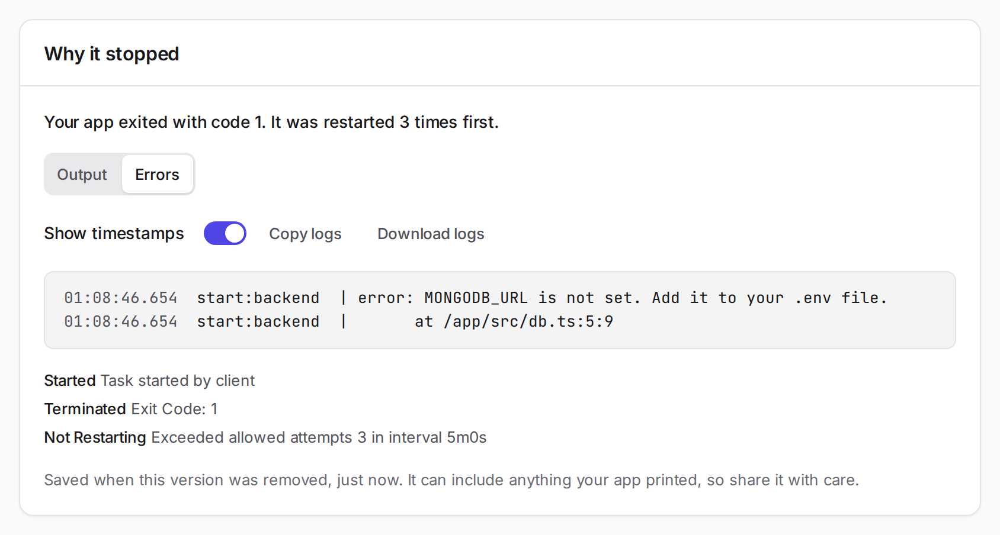
  <figcaption>The backend stopped because <code>MONGODB_URL</code> was missing.</figcaption>
</figure>

### The page is blank, shows 404, or Errors mention `frontend/dist/index.html`

The app is running, but no server sends the frontend's files. For a Vue app, check that **Build script** on the **Settings** tab is `build`, and check the steps in [If your frontend uses Vue](#vue). With the local guide's frontend, check that `start` runs both servers.

### Errors say "not authorized on myapp to execute command"

Your code names a database, as in `client.db("myapp")`. Use `client.db()`, so your app uses the database in the connection string.

### Saving data fails with "not authorized", but reading still works

Your database is over its 2 GB limit, and the **Settings** tab says "Writes are paused because this database is over its size limit." Delete enough data to leave at least 5% of the limit free, and saving works again within a few minutes. If your app needs more space, ask the course staff.

### Signing in to your app works locally but gets `FORBIDDEN` on the platform

Check that `PUBLIC_ORIGIN` is set under **Environment variables** to your app's exact address, `https://<name>.mit-sdg.dev`, and that your code reads it, as in [If your app keeps sessions in a cookie](#sign-in).

### Errors say "read-only file system", or files disappear after a deployment

Your app can't keep files on the server: its folders are read-only, and anything written elsewhere is gone after the next deployment. Save data in the database and files in S3 storage, as in [Storing files with S3](#s3).

### It works locally but fails after deployment

Look for a setting that exists only in `.env`, a file your app reads but `.gitignore` keeps out of git, or a commit you haven't pushed. To catch the last two, clone your repository into a new folder, copy in `.env`, and follow [Try it, then push](#try-it) there.

## Optional features and background

<details id="private-repository">
<summary>Deploying from a private repository</summary>

To deploy a private repository, you add a deploy key to it on GitHub. The key lets the platform read that one repository. Someone with admin access to the repository must add it.

1. Save the repository URL on the **Settings** tab. Under **Private repository**, click **Create deploy key** and copy the key.
2. On GitHub, open the repository's **Settings**, then **Deploy keys**, then **Add deploy key**. Paste the key and leave **Allow write access** off.
3. Return to your app's **Settings** tab and click **Check access**. You should see `GitHub accepts the key.`, followed by the commit your branch is on.

</details>

<details>
<summary>Letting people sign in</summary>

Your app can sign people in with their class account, with a password, or both. ConceptBox, the example app from lecture, includes each as a part you can copy into a sync-engine app. Its README's [Copy parts into your app](https://github.com/mit-sdg/conceptbox#copy-parts-into-your-app) section lists the files and how to connect them. Both parts store sessions in a cookie, so also make the change in [If your app keeps sessions in a cookie](#sign-in).

- **With a class account**, classmates and course staff sign in through Commons, as you did in step 2. Commons sign-in works at `https://<name>.mit-sdg.dev`, and at `http://localhost:<port>` or `http://127.0.0.1:<port>` while you develop. Copy the "Signing in with Commons" part. To write sign-in yourself, follow [Commons' deployment guide](https://github.com/mit-sdg/commons/blob/main/DEPLOYMENT.md#sign-in-with-commons-for-course-apps), which lists the requests your server makes.
- **With a password**, anyone can sign up. Copy the "Signing in with a password" part rather than writing your own. It saves an argon2id hash of each password, never the password itself. Your app will hold strangers' passwords, so ask people only for what your app uses, and don't collect anything sensitive.

</details>

<details>
<summary>Using PostgreSQL instead of MongoDB</summary>

Click **Add PostgreSQL**. With the suggested variable names, the platform sets `DATABASE_URL`, which includes the password, and the standard `PG` variables, such as `PGHOST` and `PGUSER`. Most PostgreSQL clients can connect with `DATABASE_URL` alone.

</details>

<details id="s3">
<summary>Storing files with S3</summary>

S3 storage is file storage the platform provides. Your app can't keep files on the server, so keep uploaded files in S3 storage. Under **Databases and storage**, click **Add S3 storage** and keep the suggested variable names.

| Variable | What your app uses it for |
| --- | --- |
| `AWS_ACCESS_KEY_ID`, `AWS_SECRET_ACCESS_KEY` | Credentials. Keep them on the server. |
| `AWS_REGION` | The region. Use the supplied value. |
| `S3_BUCKET` | Your app's bucket. |
| `AWS_ENDPOINT_URL_S3` | The private endpoint, for requests from your server. |
| `S3_PUBLIC_ENDPOINT` | The public endpoint, for URLs sent to browsers. |

Bun's S3 client reads the credentials, region, and bucket from these variables. Pass in the endpoints:

```ts
import { S3Client } from "bun";

// For your server's own reads and writes.
export const s3 = new S3Client({ endpoint: process.env.AWS_ENDPOINT_URL_S3 });

// Only for signing URLs that browsers will use.
export const publicS3 = new S3Client({ endpoint: process.env.S3_PUBLIC_ENDPOINT });
```

Use `s3` on the server to read and write files, as in `await s3.write("notes/hello.txt", "Hello!")` and `await s3.file("notes/hello.txt").text()`.

For a browser upload, your server can make a temporary signed URL. The browser sends the file there without needing your storage credentials:

```ts
// On the server
const key = `uploads/${crypto.randomUUID()}`;
const url = publicS3.presign(key, { method: "PUT", expiresIn: 600 });

// In the browser, with the url from the server
await fetch(url, { method: "PUT", body: file });
```

Save `key` in your database so your code can find the file later. For downloads, use `publicS3.presign(key, { expiresIn: 300 })`.

A few rules for signed URLs:

- Check the person's permission to use a file before signing its URL. Anyone with that URL can use it until it expires.
- Always set `expiresIn`. Bun's default is a whole day.
- Browsers can upload only from `https` pages on `mit-sdg.dev`, so try browser uploads on your deployed app, not on `localhost`. The rule applies only to browsers; anyone can use a signed URL from another tool.
- Each upload can be up to 100 MB, and your app's storage holds up to 5 GB and 100,000 files.

For Node.js, use `@aws-sdk/client-s3` and `@aws-sdk/s3-request-presigner`. They read the same credentials and region variables. Pass in the endpoints, and set `forcePathStyle` on both clients:

```ts
import { S3Client, PutObjectCommand } from "@aws-sdk/client-s3";
import { getSignedUrl } from "@aws-sdk/s3-request-presigner";

const s3 = new S3Client({ endpoint: process.env.AWS_ENDPOINT_URL_S3, forcePathStyle: true });
const publicS3 = new S3Client({ endpoint: process.env.S3_PUBLIC_ENDPOINT, forcePathStyle: true });

const key = `uploads/${crypto.randomUUID()}`;
const command = new PutObjectCommand({ Bucket: process.env.S3_BUCKET, Key: key });
const url = await getSignedUrl(publicS3, command, { expiresIn: 600 });
```

</details>

<details>
<summary>Choosing the Bun or Node.js version</summary>

The `packageManager` line from step 1 names an exact Bun version. To specify a range, remove the `packageManager` line and use `engines` instead:

```json
  "engines": { "node": ">=22" }
```

`engines.bun` works the same way. If `package.json` doesn't specify a version, the platform checks `.nvmrc` or `.node-version` for Node.js, or `.bun-version` for Bun. Without any of these, it uses the platform's default.

The platform uses the newest release in the range. For Node.js, it uses the newest long-term support (LTS) release in the range, so `>=22` won't select a short-lived odd-numbered release. Node.js versions before 20 and Bun versions before 1.1 aren't supported.

The **Deploy** tab shows which version a commit names, and each deployment records the exact version it used.

</details>

<details>
<summary>How the platform works underneath</summary>

TIG, CSAIL's infrastructure group, runs an OpenStack cloud, and 6.1040 Apps runs in a project there. OpenStack is open-source software for running your own cloud of virtual machines, much like a private AWS.

Every machine runs NixOS. Its image is built from one commit of the platform repository and boot-tested before use. Machines aren't updated in place; an update replaces the image.

There are five kinds of machines:

- The admin machine runs Nomad, which schedules app containers, and the controller that manages deployments.
- The ingress machine runs Traefik, which routes each app's address to the right app.
- The storage machine runs a separate PostgreSQL or MongoDB server for each app's database, each with its own memory, CPU, and disk limits. It also runs Garage, an S3-compatible file store with a separate bucket for each app, and the private registry for app images.
- Each app gets its own worker machine, with no SSH and no persistent disk.
- Each build gets a single-use builder machine.

When you deploy, the platform fetches the exact commit. A fresh builder uses BuildKit to build a container image from the official Node.js or Bun image. The builder pushes the image to the private registry and is then deleted. The platform starts a fresh worker for your app, and Nomad runs the image there. Traffic switches only after the app, the scheduler, and the public address all pass their health checks. Starting these virtual machines is most of the 10 minutes.

Public traffic reaches Cloudflare first, which handles HTTPS. Traefik then forwards it to the app. Databases and S3 files go into encrypted backups every night.

Students don't get SSH, OpenStack, or database-admin access. Environment variables stay on the platform.

The code is public. You can read the [platform repository](https://github.com/mit-sdg/openstack-deployment-infra) and [Commons](https://github.com/mit-sdg/commons), the class site whose accounts you use to sign in.

</details>
